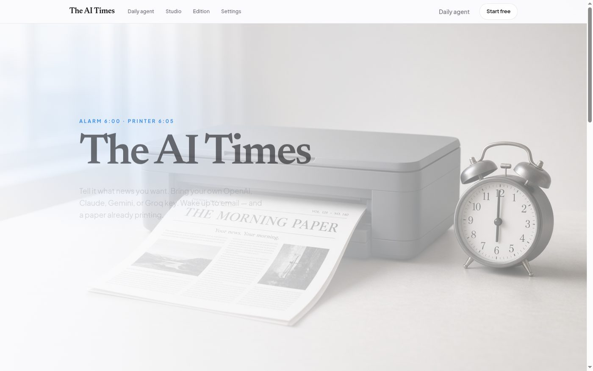
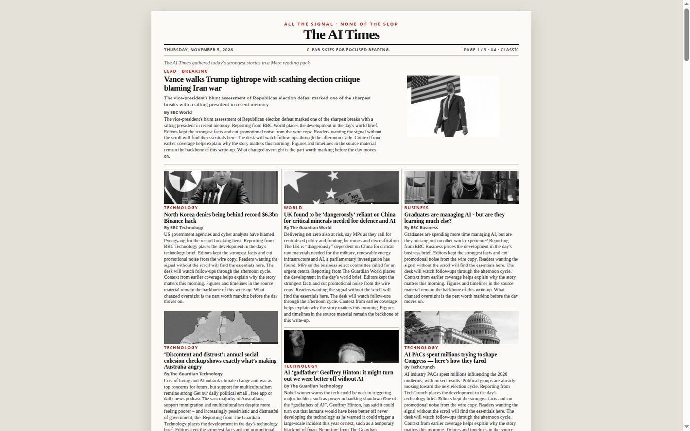
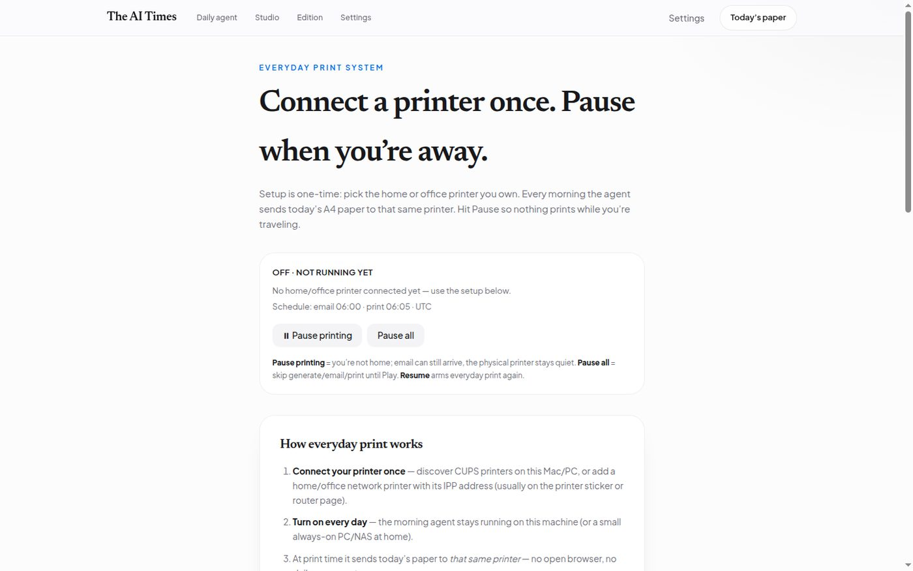
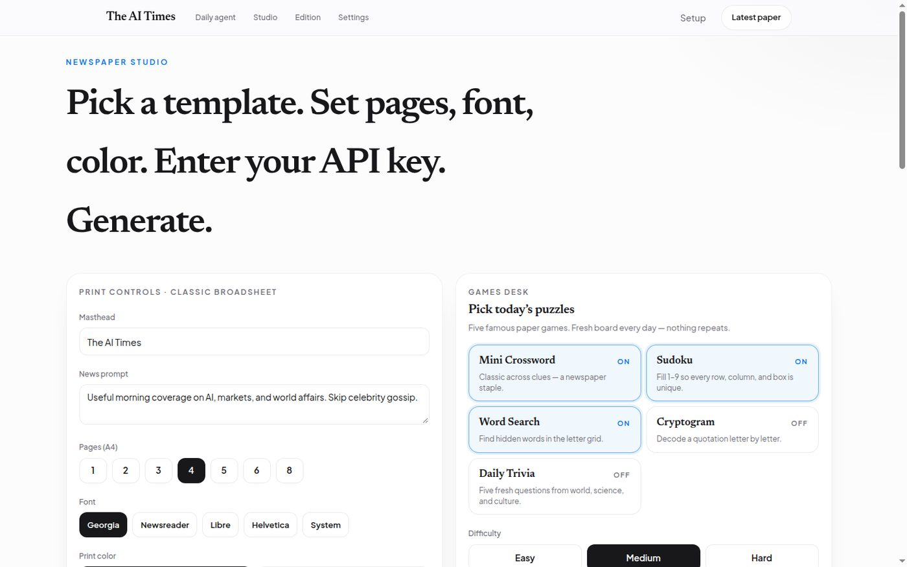

<p align="center">
  
</p>

<h1 align="center">The AI Times</h1>

<p align="center">
  <strong>Wake up to a printed paper — not a feed.</strong><br/>
  Interest-matched morning newspaper. Emailed daily. Printed on your Wi‑Fi printer.<br/>
  Pause when you’re away. Resume when you’re home.
</p>

<p align="center">
  <a href="#quick-start"></a>
  <a href="LICENSE"></a>
  <a href="#stack"></a>
  <a href="#daily-agent"></a>
</p>

---

## Why this exists

Most news products optimize for **engagement**. The AI Times optimizes for **signal**.

| Old morning | With The AI Times |
|---|---|
| Infinite scroll, ads, outrage | One A4 paper, your interests only |
| Tap Print every day | Printer runs itself at 6:05 |
| Miss it while traveling | **Pause printing** → **Resume** when home |

Built for people who still believe a paper on the table beats another tab.

---

## Demo

<p align="center">
  
  
</p>
<p align="center">
  
  
</p>

> **Hook for Show HN / Product Hunt:**  
> “An always-on agent that turns RSS into *The [Your Name] Times*, emails it at 6:00, and AirPrints it at 6:05 — with a Pause button for when you’re not home.”

---

## Features

- **Personal or company paper** — *The Sairam Times*, Herald, Post, or *The Acme Times*
- **News prompt + BYOK** — OpenAI, Claude, Gemini, Groq, Ollama, or offline desk
- **Always-on agents** — Scrapling + RSS desk, morning delivery, print daemon (Python)
- **Dense A4 layouts** — classic / modern / compact / broadsheet / magazine
- **Wi‑Fi / AirPrint / IPP** — connect your home or office printer **once**
- **Pause / Resume** — skip printing while traveling; email can still arrive
- **Daily puzzles** — crossword, sudoku, word search, cryptogram, trivia (unique per day)
- **Share** — WhatsApp, Slack webhook, mailto, copy link

---

## Quick start

```bash
git clone https://github.com/firstninja-v/the-ai-times.git
cd the-ai-times
npm install
npm run agents:install
npm run dev
```

Open **http://127.0.0.1:43123**

1. **Compose your paper** → `/setup`
2. **Connect Wi‑Fi printer + schedule** → `/agent` → **Turn on every day**
3. **Run once now** to prove generate → email → print

```bash
# Keep agents running (or use the Turn on every day button)
npm run agent:news      # wires all day
npm run agent:morning   # generate → email → print on schedule
npm run agent:print     # printer loop / discovery
```

---

## Daily agent

Open [`/agent`](http://127.0.0.1:43123/agent):

1. **Scan Wi‑Fi printers** or paste `ipp://192.168.x.x/ipp/print`
2. **Connect this printer** once
3. Set email time / print time
4. **Turn on every day**
5. Leaving town? **Pause printing** → back home? **Resume**

No browser tab required after that. Keep the machine (or a small home server) on.

---

## Stack

| Layer | Tech |
|---|---|
| App | Next.js · TypeScript · Tailwind · shadcn/ui |
| Agents | Python — `morning_daemon.py`, `news_agent.py`, `print_daemon.py` |
| Paper desk | `agents/newspaper/` — fetch, layout, images, puzzles, Wi‑Fi IPP |
| Runtime | `.ai-times/` profiles, printers, delivery pause state, inbox |

---

## Project layout

```
src/                 # Next.js UI + APIs
agents/              # Python daemons + newspaper studio
docs/shots/          # README screenshots
banner.jpg           # GitHub banner
LICENSE
```

---

## Launch checklist (Repo of the Day)

Use [`.github/LAUNCH.md`](.github/LAUNCH.md) for the full list. Short version:

- [ ] Push this `main` to GitHub (so Python agents + banner appear)
- [ ] Set **About** description + topics from [`.github/REPO_TOPICS.txt`](.github/REPO_TOPICS.txt)
- [ ] Social preview: upload `docs/og-card.jpg` in repo Settings → Social preview
- [ ] Pin the repo on your profile
- [ ] Post **Show HN** with the hook above + 20s demo
- [ ] Share in r/selfhosted + r/rss with a GIF of print/pause

---

## License

MIT — see [LICENSE](LICENSE).

<p align="center"><sub>All the signal · None of the slop</sub></p>
